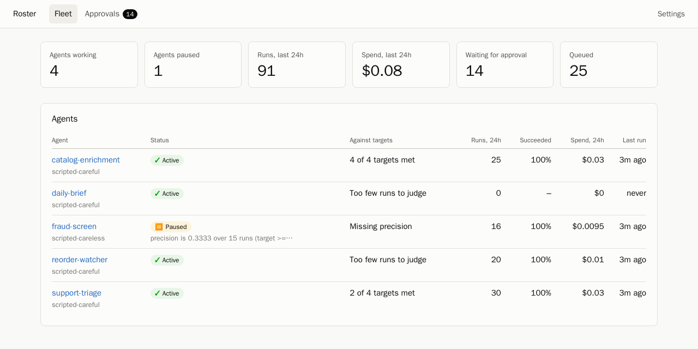
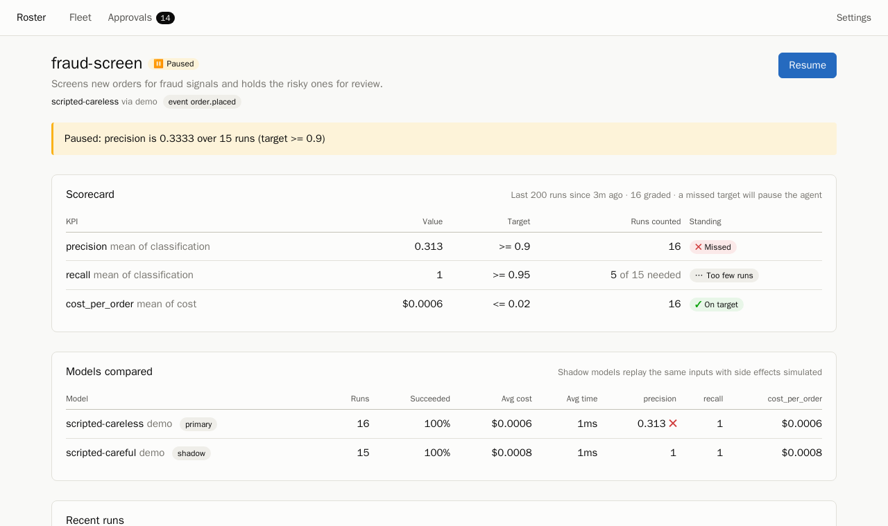
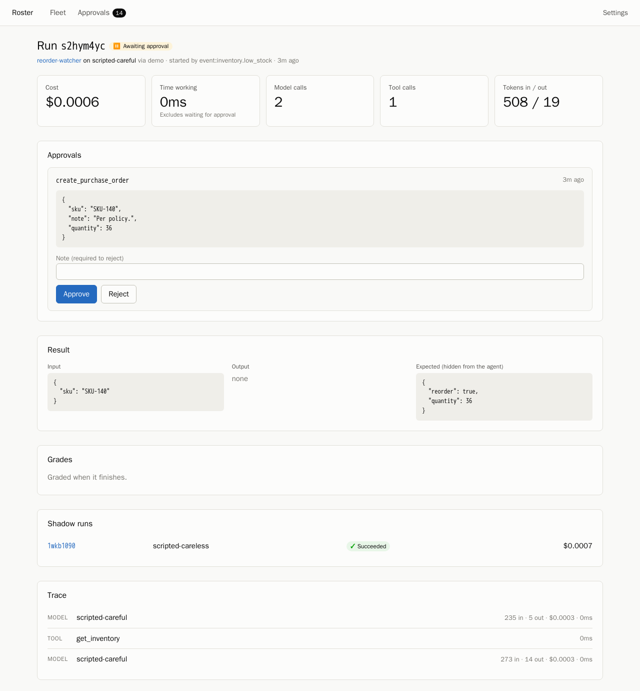

# Roster

Roster is a small framework for building AI agents, running them on their own,
and measuring whether they earn their keep. You describe an agent in a YAML
file: what it is told, which model and tools it uses, what starts it, and the
numbers it is judged on. Roster runs it, records every step, grades every run,
and pauses the agent when it misses its targets.

It is written in Go and TypeScript, exposes a GraphQL API, stores everything in
Postgres, and deploys to Google Cloud Run. It works with Claude, OpenAI, Grok
and open-source models served by Ollama.



## What it does

- **Build.** An agent is one YAML file. Tools are declared, not coded: a tool
  can be a GraphQL operation against an internal API, a tool from an MCP
  server, or a Go function. See [the spec reference](docs/agent-spec.md).
- **Run.** Agents start on events, schedules, webhooks or by hand. A worker
  drives the model, validates and executes its tool calls, and stops at a
  result, a limit, or a call that needs a person's approval.
- **Measure.** Each agent declares KPIs with targets. Graders score every run:
  against ground truth, against run facts such as cost and latency, or by an
  LLM judge with a rubric. A scorecard aggregates the scores over a window.
- **Act.** An agent that misses a target, with enough runs to be sure, is
  paused, and the reason is written to its audit trail.
- **Compare.** An agent can shadow its own work on other models. Shadow runs
  replay the same inputs with side effects simulated, so the comparison is
  like for like and nothing happens twice.



## Try it without any API key

You need Docker.

```sh
docker compose up --build -d
docker compose exec roster /roster agents apply --examples --demo
docker compose exec roster /roster shop simulate --orders 40
```

Open <http://localhost:8080>.

The first command starts Postgres and Roster with a demo online shop attached.
The second creates five example agents. The third generates customers, orders,
tickets and stock positions, and emits an event for each; the agents pick them
up within a second or two.

`--demo` swaps the models for two **scripted stand-ins**. They are not language
models, and their scores say nothing about any real model. One follows each
agent's instructions exactly; the other answers without looking anything up.
They exist so that every part of Roster has something to show:

- `fraud-screen` runs on the careless stand-in. After about 15 orders it is paused
  for missing its precision target. Its page shows the careful stand-in, as a
  shadow, getting the same orders right.
- `reorder-watcher` drafts purchase orders that wait in the **Approvals**
  inbox. Approve or reject them there, or approve them all with
  `docker compose exec roster /roster work --approve`.
- Any run opens to a full trace: each model call and tool call, with tokens,
  cost and timing.

`docker compose exec roster /roster report` prints the scorecards as Markdown.

## Run it on real models

Set the keys for the providers you want before starting the stack, then apply
the examples without `--demo`:

```sh
export ANTHROPIC_API_KEY=...    # the examples' primary model
export OPENAI_API_KEY=...       # optional: shadow models
export XAI_API_KEY=...          # optional: shadow models
docker compose up --build -d
docker compose exec roster /roster agents apply --examples
docker compose exec roster /roster shop simulate
```

Ollama is reached at `http://host.docker.internal:11434` by default; pull the
model a spec names (`ollama pull llama3.2`) before using it. A spec that names
a provider with no key fails its runs with "provider is not configured", and
the scorecard will say so.

Runs on real models cost money. Every agent has a `max_cost_usd` limit per
run, and `roster shop simulate` takes flags for how many scenarios to create.

## Writing an agent

An abridged example:

```yaml
name: fraud-screen
description: Screens new orders for fraud signals and holds the risky ones.

model:
  provider: anthropic
  name: claude-opus-5-5
  effort: low

instructions: |
  You screen new orders for an online shop. ...
prompt: "Screen order {{.order_id}}."

triggers:
  - event: order.placed

tools:
  - name: get_order
    description: Fetch an order with the customer who placed it.
    input_schema: {type: object, properties: {id: {type: string}}, required: [id]}
    graphql:
      endpoint: ${SHOP_GRAPHQL_URL}
      headers: {Authorization: "Bearer ${SHOP_API_TOKEN}"}
      query: |
        query($id: ID!) { order(id: $id) { id totalCents customer { email chargebacks } } }
  - name: hold_order
    description: Stop the order from shipping until a person reviews it.
    side_effect: true          # simulated in shadow runs
    graphql: { ... }

output:
  schema: {type: object, properties: {flag: {type: boolean}}, required: [flag]}

kpis:
  - {name: precision, grader: classification, metric: precision, params: {field: flag}, target: ">= 0.9"}
  - {name: recall, grader: classification, metric: recall, params: {field: flag}, target: ">= 0.95"}
  - {name: cost_per_order, grader: cost, target: "<= 0.02"}

review: {window: 200, min_runs: 15, on_breach: pause}

shadow:
  - {provider: openai, name: gpt-6.1-sol, sample_rate: 0.25}
```

The five complete examples are in [`agents/`](agents/). The fields are
described in [docs/agent-spec.md](docs/agent-spec.md).

```sh
roster agents validate my-agent.yaml    # check it
roster agents apply my-agent.yaml       # create or update it
```

## How an agent is judged

A **grader** turns one finished run into numbers.

| Grader | What it measures | Needs |
| --- | --- | --- |
| `expected` | Whether output fields match ground truth | Ground truth on the run |
| `classification` | Precision and recall of a yes/no field | Ground truth on the run |
| `judge` | A 1–5 score from a model reading a rubric | A judging model |
| `outcome` | Whether the run finished without failing | Nothing |
| `cost`, `latency`, `steps` | Spend, time and effort per run | Nothing |
| `approvals` | How often people approve what the agent asks for | Approval-gated tools |

**Ground truth** is attached to a run when it is triggered and is never shown
to the agent. It can also arrive later, such as a chargeback on an order the
agent waved through: the `labelRun` mutation attaches it and regrades the run.

A **KPI** picks one metric from a grader, aggregates it over the agent's
recent runs (mean by default; also sum, min, max, p50, p95) and compares it
with a target. A KPI with fewer than `min_runs` samples is never judged.

After every graded run the agent's **scorecard** is reviewed. If a KPI misses
its target, the agent is paused, or flagged if its policy is `alert`. A paused
agent takes no new work, and what it had queued waits. Resuming it restarts
the review window, so the runs that got it paused do not pause it again.



## Architecture

```
events, schedules, webhooks, Pub/Sub
              │
              ▼
        jobs table  ◄── approvals decided
     (Postgres queue)
              │
              ▼
           worker ──► agent loop ──► model provider (Claude, OpenAI, Grok, Ollama)
              │            └──────► tools (GraphQL, MCP, Go)
              ▼
     runs, steps, approvals
              │
              ▼
          graders ──► scores ──► scorecard ──► review ──► pause or alert
              │
              ▼
   GraphQL API ──► dashboard (TypeScript, React)
```

One binary does everything. `roster serve` runs the API, the dashboard, the
workers and the scheduler in one process, and several instances can share a
database. The design decisions, and what each one costs, are written up in
[docs/design.md](docs/design.md).

| Path | What is there |
| --- | --- |
| `internal/spec` | The YAML agent spec and its validation |
| `internal/llm` | Provider-neutral conversation types and the provider adapters |
| `internal/tool` | Tools: schema validation, GraphQL operations, MCP servers |
| `internal/agent` | The agent loop: tool calls, approvals, shadow mode |
| `internal/scoring` | Graders, scorecards and the review policy |
| `internal/fleet` | The control plane: triggers, the worker, grading, the scheduler |
| `internal/store` | Postgres persistence, the job queue and migrations |
| `internal/graph` | The GraphQL API (schema-first, gqlgen) |
| `internal/server` | HTTP: API, webhooks, Pub/Sub push, scheduler endpoints |
| `internal/shop` | The demo store, its scenario generator and its own GraphQL API |
| `agents/` | Example agent specs |
| `web/` | The dashboard |
| `deploy/terraform` | Google Cloud deployment |

## Deploying to Google Cloud

[`deploy/terraform`](deploy/terraform) sets up Cloud Run, Cloud SQL for
Postgres, Secret Manager, an Artifact Registry repository, a Pub/Sub topic for
events and two Cloud Scheduler jobs.

```sh
cd deploy/terraform
terraform init
terraform apply -var-file=my.tfvars -target=google_artifact_registry_repository.roster
docker build -t REGION-docker.pkg.dev/PROJECT/roster/roster:v1 ../..
docker push REGION-docker.pkg.dev/PROJECT/roster/roster:v1
terraform apply -var-file=my.tfvars
terraform output -raw api_token     # enter this under Settings in the dashboard
```

By default the service scales to zero. Nothing runs between requests, so
in-process workers are off and Cloud Scheduler calls `/internal/tick` and
`/internal/work` every minute. For steadier throughput set `min_instances = 1`
and `workers` above zero. To deliver an event, publish to the `roster-events`
topic with an `event` attribute and a JSON body.

## Development

```sh
make db           # Postgres in Docker, on port 54329
make test         # Go tests; they create and drop their own databases
make web-test     # dashboard type-check and tests
make generate     # regenerate GraphQL server code after editing a schema
```

Go 1.27 and Node 24 are what CI uses. Run the dashboard against a local server
with `cd web && npm run dev`; after changing the GraphQL schema, `npm run
codegen` regenerates the dashboard's types.

The tests do not call any model provider. The provider adapters are tested
against local servers that speak each provider's wire format, and the example
agents are tested end to end against the demo store with the scripted
stand-ins in place of models.

## Status and limits

Roster is a working demonstration, not a hardened product.

- The Claude, OpenAI, Grok and Ollama adapters have been tested against each
  provider's request and response formats but not yet against the live
  services. Expect to adjust details on first contact.
- The Terraform configuration passes `terraform validate` but has not been
  applied to a real project.
- Authentication is a single shared bearer token. Who did what in the audit
  trail comes from a header the dashboard sets, so it is only as trustworthy
  as the network in front of it.
- Token prices are a table in [`internal/pricing/pricing.yaml`](internal/pricing/pricing.yaml),
  correct as of October 2026. Prices change; override the table with
  `ROSTER_PRICING_FILE`.
- A run whose worker dies is failed, not resumed. See the design notes for why.

## License

MIT
